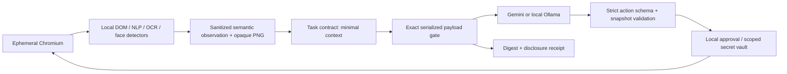

# PrivacyLens architecture and codebase guide

## What we built
A local browser-agent control plane with task-scoped disclosure. It deliberately separates an untrusted planner's proposed actions from local authority. The original contribution is the integrated workflow: task contracts, progressive visual disclosure, field-scoped secret capabilities, current-page approval checks and request receipts, paired with a reproducible ablation. None of these primitives is claimed to be a new invention.

## Trust boundaries
The webpage, model output, target labels and task text may contain hostile instructions. They never become executable code, arbitrary selectors or a destination supplied to the model gateway. The model receives random target handles and permitted secret-reference names. The browser resolves handles locally and checks a fingerprint of URL, visible text, fields and geometry before acting. A stale action fails rather than operating on a new page.

The planner's JSON schema is regenerated for each observation: current snapshot and target handles are enumerated; completed secret fields are excluded from further fill proposals; each action variant has exactly its relevant fields. A bounded, sanitized recent-action summary gives continuity without exposing values or old raw pages. The model proposes a consequential click normally; approval is collected by the executor, never inferred from the model's wording.

All task inputs and observations pass local sanitization. The model HTTP body is serialized once, inspected and hashed, then those same bytes are passed to HTTPX. The only image exemption is the exact locally composed image at the exact provider image path. Payload fields named `data` or `image_base64` are not generally exempt. API credentials are separate authentication headers, necessarily sent to the selected API provider; they are not browser-page context.

Secret values are in memory, bound to scenario, origin, recognized field purpose and a two-use limit. Action validation binds their use to the current snapshot. Authorized form submission necessarily sends values to the destination website; this project protects the model pathway, not all network traffic. Labels and form semantics are not a cryptographic proof of website intent. The preset origin is assumed to be an authorized site; a malicious same-origin page remains an important limitation.

## Modules and questions judges may ask
| Module | Responsibility | Why it exists |
|---|---|---|
| `contracts.py` | Strict request/action types; scenario capabilities | Reject tool invention and unrelated action properties |
| `fixtures.py` | Seeded synthetic pages and separate annotations | Reproducible evaluation without personal data |
| `privacy.py` | Patterns, Presidio, OCR, YuNet, opaque PNG composition, outgoing gate | Detect locally and avoid raw fallback |
| `browser.py` | DOM extraction, target registry, capture, fingerprint, execution | Keep raw selectors, values and URLs out of reasoning |
| `agent.py` | Planner adapters, bounded loop, vault, approvals and receipts | Model proposes; local policy authorizes |
| `evaluation.py` | Text corpus and local adversarial probes | Evidence rather than hard-coded success claims |
| `app.py` | Local API, session/origin boundary and fixtures | Separate control origin (8765) from untrusted pages (8766) |
| `frontend/src/main.tsx` | Privacy Lab scenario studio, preview, approvals, evidence | Make the trust boundary inspectable |
| `frontend/src/AgentWorkspace.tsx` | Prompt sidebar, supported address, action status, previews and approval | Primary user workflow, separate from evaluation |

## Capture and disclosure
Visible DOM text is scanned locally. Every input field and unsupported media surface is conservatively covered. Private conversation/participant regions are protected by contextual policy. OCR scans the full screenshot to catch text in pixels; YuNet adds detected face boxes. The screenshot is rebuilt as RGB PNG with solid rectangles, not blur, and no original image metadata. Original and sanitized previews are local only.

Contract mode shares controls and completion status; baseline mode shares full sanitized text. Neither automatically transmits screenshots. A planner may request an enumerated region; user approval releases only its sanitized crop. Gemini supports the image path; local Ollama currently uses text only. Whole-image and text-only ablations must not be conflated.

## Failure policy
Missing required NLP/OCR, changing capture, stale target, invalid action, unapproved disclosure, denied operation, unknown secret, detector exception and transport failure stop the run. No raw fallback. Loops are bounded by step, wall-time and approval deadlines. Transport redirects and environment proxies are disabled. No automatic retries risk duplicate consequential actions. Browser sessions are ephemeral and Stop & clear closes the context and removes run secrets/previews.

## Honest limitations
This is a hackathon prototype, not a proof of complete privacy. Unknown PII, novel encodings, split text, CSS-generated content and small/occluded faces can evade detection. Conservative media masking loses context. Screenshots/DOM can differ in dynamic applications. The page fingerprint is a practical stale-action defense, not atomic execution or a defense against a compromised browser. The host OS, local processes, malicious extensions and provider retention policies are outside the guarantee. Local dashboard access is not multi-user authentication. Cloud data handling depends on the provider/account. Raw data exists briefly in memory and the local preview; never export it in real-user runs.

Receipts are hashes of checked bytes and disclosures, not independently signed proofs and not evidence that all sensitive data was detected. A blocked action may follow an earlier permitted request. A model saying `done` is reported separately from a verified fixture outcome. The local deterministic driver verifies plumbing, not AI reasoning quality.

## Prompt entry and Groq schema update
The root route is the prompt-driven Browser Agent; `/lab` is the scenario/evidence workspace. `/api/agent/runs` accepts instructions and an exact allowlisted page URL, then reuses the existing task/origin policy. Unsupported addresses are rejected before navigation. Groq uses a stable required-nullable wire schema to avoid provider discriminator conflicts; the current snapshot/action/target restrictions are enforced locally by `validate_text_proposal` and the executor. Gemini retains the per-observation schema. Groq pacing estimates a rolling token budget; shared-account use can still cause rate limits.
