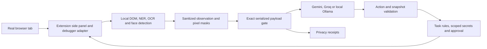

# Architecture and codebase guide

## Data flow

The extension uses a paired localhost WebSocket to the FastAPI service. Its side panel contains tasks, approval controls, local previews and provider settings. The real tab remains interactive and survives Stop or Take control. The root web page provides setup; `/lab` provides evaluation tools. An isolated browser adapter supports automated fixture benchmarks.

## Module map
| Module | Responsibility |
|---|---|
| `extension/panel.html`, `panel.js` | Prompts, planner selection, privacy controls, approvals and receipts |
| `extension/background.js` | Active-tab control and debugger command transport |
| `backend/extension_api.py` | Pairing, allowed extension origins and extension endpoints |
| `backend/extension_transport.py` | Loopback WebSocket browser adapter |
| `backend/contracts.py` | Strict action/request types and scenario capabilities |
| `backend/browser.py` | DOM collection, opaque target handles, capture and execution |
| `backend/privacy.py` | Detectors, masking and outbound data checks |
| `backend/agent.py` | Model adapters, bounded agent loop, secret vault, approvals and receipts |
| `backend/fixtures.py` | Synthetic websites and independently evaluated outcomes |
| `backend/evaluation.py` | Text corpus and local policy probes |
| `backend/app.py` | Local HTTP API and session/origin controls |
| `frontend/src/main.tsx` | Privacy Lab and setup interface |

## Observation and disclosure
Visible DOM spans and screenshot pixels are screened locally. Sensitive-purpose fields and private regions receive masks. Ordinary images use OCR and face detection. The sanitizer uses solid pixel rectangles and fresh PNG encoding. Private/Public profiles control contextual masking while retaining protection for recognized identifiers and known secrets.

The ordinary model observation contains sanitized text and opaque controls, without screenshot transmission. Gemini may request a named region, which requires approval before a sanitized crop is released. Groq and Ollama use text only. Task-minimal and full-sanitized-text modes support a controlled disclosure comparison.

The gateway serializes the model request once, inspects and hashes it, then transmits those exact bytes. Approved image data is exempted only at its specific provider field. Provider credentials travel as authentication, separately from browser context. Ollama requests stay on localhost.

## Local action authority
Model output is a proposal, not executable code. Local validation checks action type, target handle, snapshot, field purpose and task restrictions. Groq uses a stable wire schema with changing constraints enforced locally. Gemini uses per-observation constraints. Bounded sanitized action history provides continuity.

Secret values stay in memory and are bound to task/scenario, origin, recognized field purpose and a two-use limit. The model receives references. Authorized form entry delivers the resolved value to the website. Recognized consequential actions require approval. Draft only rejects those actions before approval. Custom tasks finish with user review; canonical fixture tasks can independently verify their outcome.

## Failure handling and trust boundaries
Invalid actions, stale observations, denied approvals and detected unsafe payloads stop execution. Capture changes trigger bounded recapture before a model request. There is no raw-data fallback. Loops and waits are bounded; provider errors do not silently trigger retries. Take control cancels the run and detaches automation. Stop also clears local overrides/previews while retaining the extension tab.

The host, local service and browser are trusted. The local service can issue browser evaluation commands, so the transport is not a sandbox against a compromised backend. Page semantics can be misleading, and detectors can miss unknown information. The project protects its model pathway rather than all browser traffic. Receipts identify checked bytes and decisions, not mathematical guarantees of complete redaction.
