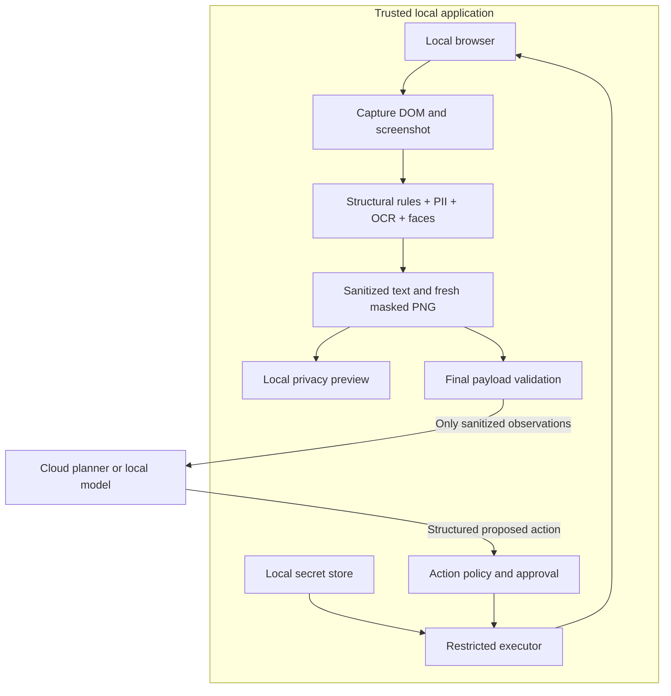

# PrivacyLens: open-source reuse and implementation research

Research date: **29 October 2026**. Based on the supplied PS-004 problem statement.

**Recommendation:** reuse browser automation, PII recognizers, OCR, face detection, model serving, and testing libraries. Build a small, explicit privacy boundary connecting them. That boundary—not a new browser or a newly trained model—is the main contribution.

This is research for the later implementation plan. It does not claim that these components have already been integrated or benchmarked. Findings come from upstream repositories, documentation, model cards, papers, repository metadata, and selected source files. The survey is broad but cannot be exhaustive of the internet. License labels below describe the inspected upstream project; dependencies, model weights, and datasets can carry separate terms. Pin exact versions and retain notices when adopting code.

## 1. The practical shortlist

| Requirement | First choice | What we reuse | What we still implement |
|---|---|---|---|
| Local browser interaction | [Playwright](https://github.com/microsoft/playwright) | Browser control, locators, screenshots, frames, test infrastructure | Safe observation format and restricted action executor |
| PII in text | [Presidio](https://github.com/data-privacy-stack/presidio) | Recognizers, confidence/context handling, replacement operators | Browser context rules, protected containers, recognition configuration |
| India-specific IDs | [Presidio supported entities](https://presidio.dataprivacystack.org/supported_entities/) | Existing `IN_AADHAAR` and `IN_PAN` recognition | Tests for formatting, partial values, OCR errors and split DOM text |
| API keys and tokens | [Gitleaks](https://github.com/gitleaks/gitleaks) | Provider-specific secret patterns and entropy detection | Adapter for page text/final payloads; no raw secret reports |
| Text in screenshots | [PaddleOCR](https://github.com/PaddlePaddle/PaddleOCR) | Local OCR and text locations | Mapping recognizer spans to pixel masks |
| Browser-only OCR alternative | [Tesseract.js](https://github.com/naptha/tesseract.js) | Browser/Node OCR through WebAssembly | Local packaging and explicit bounding-box output configuration |
| Faces | [OpenCV YuNet](https://github.com/opencv/opencv_zoo/tree/main/models/face_detection_yunet) | Local face boxes | Opaque masks, participant-label handling, failure policy |
| Contextual names/addresses | [GLiNER PII model](https://huggingface.co/urchade/gliner_multi_pii-v1) | Local contextual entity detection | Domain-specific labels and threshold evaluation |
| Screenshot redaction starting point | [Screenshot Redactor](https://github.com/cleanroom-ai/screenshot-redactor) | Combined local image-processing pipeline and preview | DOM integration, action loop, India-specific coverage and egress gate |
| Closest complete application | [NAYAN](https://github.com/Rohinth-S/NAYAN) | Extension structure, sanitized observations, validation and preview patterns | Audit/reproduce behavior, extend gaps, benchmark independently |
| Local planner | [Ollama](https://github.com/ollama/ollama) | Model runtime and structured outputs | Restricted action schema, local-only configuration, evaluation |
| Synthetic test data | [Faker](https://github.com/joke2k/faker) | Generated identities and fixtures | Five scenario pages, annotations, canaries, expected outcomes |
| Independent traffic inspection | [mitmproxy](https://github.com/mitmproxy/mitmproxy) | HTTP(S)/WebSocket inspection | Test routing, leakage checks, evidence with limited retention |

Do not install every alternative. Choose one browser backend, one primary text detector, one OCR engine, and one planner runtime initially.

## 2. Projects closest to an existing PrivacyLens

### NAYAN — the highest-value full-application candidate

[Repository](https://github.com/Rohinth-S/NAYAN) · [MIT license](https://github.com/Rohinth-S/NAYAN/blob/main/LICENSE)

Its stated scope is unusually close: local visual redaction, browser interaction, privacy grades, Ollama reasoning, and grounded actions. It is a small project, so feature claims require reproduction rather than assuming maturity from its README.

Selected source inspection found real integration points:

- [`egress.ts`](https://github.com/Rohinth-S/NAYAN/blob/main/extension/src/egress.ts) validates observations, applies DLP/canary checks, serializes the request, and uses a controlled submission path with redirects rejected.
- [`validation.ts`](https://github.com/Rohinth-S/NAYAN/blob/main/extension/src/validation.ts) checks observation fields, image/bounds metadata, action types and snapshot association. These checks are useful; they do not prove every sensitive pixel was detected.
- Its [architecture review](https://github.com/Rohinth-S/NAYAN/blob/main/ARCHITECTURE_REVIEW.md) identifies coverage and capture-consistency limitations. Some document sections describe future directions; do not treat every proposed detector as implemented.

**Reuse decision:** investigate first if maximizing application-level reuse is the priority. Fork only after reproducing its setup and tests, then identify the exact modules we retain. Its inspected action schema uses text-input actions; a restricted `fill_secret` capability remains something to verify or add. Do not inherit claims of zero leakage or latency without our own measurements.

### Screenshot Redactor — the strongest focused image candidate

[Repository and setup](https://github.com/cleanroom-ai/screenshot-redactor) · Apache-2.0

The project combines local OCR, secret/PII rules, a PII classifier, face detection, QR/barcode detection, editable masks, and freshly encoded PNG output. It includes browser and Python variants and describes tests for unexpected uploads/third-party requests. The README explicitly acknowledges OCR misses and limitations of English name/address recognition.

**Reuse decision:** useful image pipeline or reference implementation, particularly for a TypeScript/browser implementation. Use opaque boxes for sensitive content. Its blur/pixelation options should not be our privacy mode. It is not a complete safe browser agent: we still need DOM sanitization, action validation, task state, local secret injection, and final-payload blocking. Independently validate its bundled models and tests.

### PrivAgent — relevant reference, not an approved dependency yet

[Repository](https://github.com/megtyagi/PrivAgent)

Its described purpose matches local PII redaction and safe browser execution. However, the inspected repository metadata returned no license and the inspected README did not establish one. Keep it as a discovery/reference lead; do not place it in the code-reuse shortlist until an explicit applicable license is verified.

### Available-but-Invisible GUI privacy research

[Paper](https://arxiv.org/abs/2602.10139) · [Code](https://github.com/one-step-beh1nd/gui_privacy_protection)

This work uses type-preserving placeholders and a local interaction layer so sensitive values remain usable without appearing in the cloud planner's observations. The repository contains AndroidLab-based execution and PrivScreen evaluation. It is useful architectural and evaluation research, but Android setup is unnecessary for our browser MVP. A clear applicable project license was not established in this inspection, so copying its implementation needs a further license check.

## 3. Component comparison and adoption decisions

### Browser automation and agent orchestration

| Project | Inspected license | Useful capability | Decision / integration cost |
|---|---|---|---|
| [Playwright](https://github.com/microsoft/playwright) | Apache-2.0 | Deterministic interaction and screenshots across Chromium, Firefox and WebKit | **Recommended default.** We control exactly what reaches the model. Medium integration effort for the agent/privacy loop. |
| [Browser Use](https://github.com/browser-use/browser-use) | MIT | Existing Python browser-agent loop and secret placeholders | **Alternative for faster agent behavior.** Significant privacy-adapter audit: every model input, extraction call, screenshot, history entry, retry and trace must be covered. |
| [Stagehand](https://github.com/browserbase/stagehand) | MIT | Natural-language browser actions and extraction; local execution supported | **TypeScript-oriented alternative.** Confirm interception before every model call in the pinned version. Use a local browser. |
| [LangGraph](https://github.com/langchain-ai/langgraph) | MIT | State machine, interruptions and human approval | Optional if workflow complexity justifies it. Checkpoints and tracing must never persist raw observations or secrets. |
| [UI-TARS Desktop](https://github.com/bytedance/UI-TARS-desktop) | Apache-2.0 for application | Desktop/browser operators and GUI-agent interface | Bonus desktop path. Broader input/action surfaces make it more work than the required browser demonstration. Model licenses are separate. |
| [OmniParser](https://github.com/microsoft/OmniParser) | Mixed signals across repository metadata/README; model terms vary | Screenshot UI-element parsing | Optional for canvas/desktop work. It finds UI controls, not a complete PII policy. Check exact files and weights before reuse. |

Browser Use's own [sensitive-data example](https://docs.browser-use.com/open-source/examples/templates/sensitive-data) disables vision to prevent screenshot exposure and describes local substitution of secret placeholders. Therefore, `sensitive_data` alone does not satisfy PrivacyLens. Its [agent parameters](https://docs.browser-use.com/open-source/customize/agent/all-parameters) also expose separate extraction models and fallback behavior; those are additional paths to inspect.

[Stagehand's official overview](https://www.browserbase.com/stagehand) distinguishes the local open-source SDK from hosted Browserbase. A hosted browser would put raw page state outside the local boundary before our sanitizer. Choose local execution for this problem.

OmniParser's current [README](https://github.com/microsoft/OmniParser/blob/master/README.md) distinguishes MIT-based newer icon detection from earlier AGPL detector weights. A single repository badge is insufficient to establish the terms of the whole model bundle.

### Detection and sanitization

| Project | License | Reusable part | Main limitation for us |
|---|---|---|---|
| [Presidio](https://github.com/data-privacy-stack/presidio) | MIT | Text recognizers, anonymization operators, image-redaction package | Requires our browser-context coverage and calibration. No detector guarantees complete recall. |
| [Gitleaks](https://github.com/gitleaks/gitleaks) | MIT | Secret rules/entropy and scanning | Designed around secret scanning; adapt to live text and keep matched values out of reports. |
| [detect-secrets](https://github.com/Yelp/detect-secrets) | Apache-2.0 | Python plugins for secret types and high-entropy strings | Alternative to Gitleaks. Disable network verification; code-oriented filtering may be wrong for browser payloads. |
| [PaddleOCR](https://github.com/PaddlePaddle/PaddleOCR) | Apache-2.0 | Local image text recognition | Benchmark installation, CPU latency, small fonts and multilingual screenshots. OCR is not PII classification. |
| [Tesseract.js](https://github.com/naptha/tesseract.js) | Apache-2.0 | OCR in browser/Node | Bundle worker/core/language files locally. Request the output structures needed for pixel coordinates. |
| [GLiNER](https://github.com/urchade/GLiNER) + [PII checkpoint](https://huggingface.co/urchade/gliner_multi_pii-v1) | Apache-2.0 for both inspected items | Contextual named-entity recognition | Optional improvement; verify on Indian names, addresses and Hinglish rather than assuming coverage. |
| [YuNet](https://github.com/opencv/opencv_zoo/tree/main/models/face_detection_yunet) | MIT for model directory | Lightweight face detection | Small/occluded faces can be missed; use conservative participant-tile masking where needed. |
| [Screenshot Redactor](https://github.com/cleanroom-ai/screenshot-redactor) | Apache-2.0 | Integrated local screenshot processing | Young project; India-specific IDs and agent integration require verification/adaptation. |

Presidio has moved from the old `microsoft/presidio` location to `data-privacy-stack/presidio`; use its current [installation documentation](https://microsoft.github.io/presidio/installation/) and pinned releases. The current docs include Aadhaar/PAN support and a [GLiNER integration example](https://presidio.dataprivacystack.org/samples/python/gliner/). Reuse those before creating duplicate recognizers.

The [detect-secrets README](https://github.com/Yelp/detect-secrets/blob/master/README.md) documents a `--no-verify` option because verification can make network calls. A scanner sending a candidate key to its provider would violate our intended local-detection boundary.

### Local inference, validation and testing

| Project | License | Use | Recommendation |
|---|---|---|---|
| [Ollama](https://github.com/ollama/ollama) | MIT runtime | Local model serving | First choice for an approachable local demo; model weights have their own terms. |
| [llama.cpp](https://github.com/ggml-org/llama.cpp) | MIT runtime | Quantized local inference, CPU/GPU backends | Alternative when runtime control matters more than setup simplicity. |
| [Pydantic](https://github.com/pydantic/pydantic) / [Zod](https://github.com/colinhacks/zod) | MIT / MIT | Strict input/action schemas | Use the one matching the backend language, plus explicit semantic authorization. |
| [Faker](https://github.com/joke2k/faker) | MIT | Synthetic fixture values | Use seeded data; custom generators for checksum-valid/invalid IDs. Never assume generated identities cannot coincide with real ones. |
| [Hypothesis](https://github.com/HypothesisWorks/hypothesis) | MPL-2.0, with noted exceptions | Property-based/adversarial variations | Useful for separators, Unicode, field combinations and failure cases. See [license](https://github.com/HypothesisWorks/hypothesis/blob/master/LICENSE.txt). |
| [mitmproxy](https://github.com/mitmproxy/mitmproxy) | MIT | Independent network inspection | Use in controlled tests; configure all tested clients to traverse it and prevent bypass. |
| [Promptfoo](https://github.com/promptfoo/promptfoo) | MIT | Prompt/model regression and adversarial evaluation | Optional. Configure local providers and disable telemetry/updates; hosted generators/graders can still send data externally. |
| [AgentDojo](https://github.com/ethz-spylab/agentdojo) | MIT | Prompt-injection evaluation patterns | Adapt attack ideas to our webpages; its benchmark is not a drop-in browser PII test. |
| [BrowserGym](https://github.com/ServiceNow/BrowserGym) | Apache-2.0, verified in [license file](https://github.com/ServiceNow/BrowserGym/blob/main/LICENSE) | Broader browser-agent benchmark harness | Later robustness evaluation; additional environments increase setup work. |
| [MiniWoB++](https://github.com/Farama-Foundation/MiniWoB-plusplus) | MIT | Small web-interaction environments | Fixture inspiration; current README says maintenance mode and lists Linux/macOS support. Custom PS-004 pages are more direct. |
| [LLM Guard](https://github.com/protectai/llm-guard) | MIT | Existing scanner architecture | **Do not choose as the core dependency:** repository and associated models are now marked archived/unmaintained in its [README](https://github.com/protectai/llm-guard/blob/main/README.md). |

For local model candidates, [Qwen3-4B](https://huggingface.co/Qwen/Qwen3-4B) is a text planner candidate and [Qwen2.5-VL-7B-Instruct](https://huggingface.co/Qwen/Qwen2.5-VL-7B-Instruct) is a vision candidate; both inspected model cards specify Apache-2.0. These are concrete starting points, not a claim that they are the newest or best models. Select after measuring the team's laptop, quantization, context size, latency and action accuracy. A text-only planner is sufficient when sanitized DOM metadata carries the needed information.

## 4. Architecture suggested by the research

This is our proposed design, not a claim about what any one dependency already guarantees.

Protect **user instructions, DOM/accessibility data, images, action results, history, URLs, titles, errors and logs**. A screenshot filter alone leaves many other disclosure paths.

Keep the raw browser and detectors local. Only the gateway process should hold cloud-model credentials and external inference access. The planner receives opaque element IDs and sanitized observations; it has no general browser, filesystem, shell, arbitrary JavaScript, or network tool. The executor receives approved action types and locally resolves their targets.

Declare two separate destinations: the external model must never receive raw protected values; a user-authorized website may receive a value through a narrowly scoped form-fill operation. This is not protection against the destination website itself, unrelated extensions, a compromised operating system, or another application's screen capture.

## 5. Remaining implementation work, and how to do it

Effort labels below are relative engineering judgments, not time estimates. High effort mostly means security-sensitive integration and testing.

### 1. Build one sanitized observation format — medium

Export a small allowlisted record containing snapshot ID, opaque page alias, visible controls, safe labels, roles, bounds and states. Never serialize the browser's complete internal objects. Exclude cookies, raw URLs, hidden fields, selectors containing values, storage contents and debugging metadata.

Read DOM information locally through Playwright. Sanitize accessible names, labels, `title`, `alt` text and other retained attributes too. Preserve only metadata useful for the task. Inspect supported frames and shadow roots; mask or omit unsupported content rather than assuming it is empty.

### 2. Combine detectors using browser context — medium

Use three overlapping sources: structural field/container rules, text patterns/checksums, and optional local OCR/NER. Treat password fields as sensitive regardless of their value. Use `autocomplete` hints such as `current-password`, `one-time-code`, `cc-number`, `cc-csc` and address fields, along with labels and nearby context.

Merge findings into records such as `{entity_type, source, local_span_or_box, confidence, reason}`. Keep the raw span/value in local memory only. A checksum failure should not make a known password/card/ID field safe: partial input and OCR errors are still sensitive.

### 3. Close India-specific and contextual gaps — medium

Enable and test Presidio's existing India recognizers. Normalize spaces, separators and relevant Unicode forms while retaining a mapping back to the original text spans. Detect split IDs across adjacent nodes. Use Aadhaar checksum recognition as one signal, alongside field context.

For PAN, use the ten-character pattern of five letters, four digits and a final letter; context improves precision. One inspected Presidio entity-description table incorrectly described its length as 12. The official [Income Tax Department format](https://traces61contents.tdscpc.gov.in/en/faq-general-pan.html) establishes ten characters. Test actual recognizer behavior rather than copying that description.

OTP detection should use authentication context, not classify every short number as an OTP. Protect medical-record sections and private-message containers as whole sensitive regions when required: removing names alone does not remove sensitive content. Add user-defined phrases/selectors and explain each masking decision locally.

### 4. Produce consistent, opaque screenshot redaction — high

Use DOM rectangles for known sensitive elements and text ranges. [Playwright screenshot masking](https://playwright.dev/python/docs/api/class-page#page-screenshot) is useful for element-level coverage; [Range.getClientRects](https://developer.mozilla.org/en-US/docs/Web/API/Range/getClientRects) provides text-range geometry. Combine those masks with OCR/face findings on the captured image.

Account for zoom, device-pixel ratio, scrolling, iframes, transforms and clipped text. Prefer viewport captures initially. Invalidate observations when the page or viewport changes. DOM collection and screenshot capture are not inherently atomic: detect changes, retry boundedly, and block or conservatively mask unstable regions. Run pixel detectors on the exact image being released.

Apply solid opaque replacement to a private image buffer, then encode a fresh PNG without copied metadata. Never put raw pixels briefly into a public preview/stream. Do not use blur, transparency, reversible layers or simple pixelation as the guarantee. Detector failure means block transmission or use an explicitly supported conservative mask mode.

### 5. Preserve useful context with placeholders — medium

Replace sensitive text with semantic placeholders such as `[REDACTED:CARD]`. For entities needed across steps, attach a random session-scoped reference, e.g. `[REDACTED:ADDRESS:r7]`. Preserve public labels and controls so the agent can still navigate.

Keep the reference-to-value map exclusively local. Do not expose unsalted hashes of low-entropy data such as phone numbers. Reset references between sessions, and disclose that repeated placeholders reveal within-session linkage. Do not retain last-four digits unless an explicit privacy policy permits it.

### 6. Add a final outgoing-payload gate — high

All inference paths must use one gateway: primary model, extraction, retries, fallback, tool results and conversation history. Validate the final structured object and scan the exact serialized request fields just before transmission. Reject unknown fields, unredacted known secrets, invalid image provenance and failed detector states.

Check destination URL, path, query and headers as well as body. An intentionally configured provider authentication key belongs only in its expected authentication header for that exact provider; page secrets must never be allowed there. Avoid redirects and arbitrary model-selected destinations.

Image content requires image-aware checks; searching base64 for a secret string cannot prove the image is redacted. Use verified compositor output, coverage assertions for known regions, and residual OCR as an additional check. Residual OCR is also fallible. Combine the gate with independent test annotations and traffic inspection.

For stronger isolation, give detector/executor processes no external inference route and allow network egress only through the gateway. A helper function alone is not a process-wide network boundary. For a hackathon, document the enforced boundary and any weaker prototype assumption precisely.

### 7. Restrict and validate model actions — high

Start with `click`, `fill_public`, `fill_secret`, `select`, `scroll`, `wait` and `done`. Use strict Pydantic/Zod schemas, reject unknown properties, and bound text lengths, steps, retries and waiting time.

Before every action, verify snapshot freshness, target existence, current role, visibility, enabled state, allowed origin and allowed action. Reject model-supplied JavaScript, arbitrary CSS/XPath, raw URLs and ungrounded coordinates. A valid JSON object can still describe an unsafe action, so authorization follows parsing.

Bind purchase, payment, deletion, account/security changes and message sending to a trusted user-approval interface. Show the concrete destination and consequence. Revalidate state after approval; approval for one action does not authorize a changed one. Fail closed for uncertain consequences.

### 8. Implement local secret injection — high

Let the model request an operation such as `{action: fill_secret, target_id: e17, secret_ref: checkout_card, snapshot_id: s9}`. The local executor resolves the reference and fills the approved field. The model never receives the value.

Authorize each secret by exact origin, task, field purpose and current page state. Possession of a reference is not enough. Do not let the model copy a password into a search box, message, URL or arbitrary field. Return only a status such as `filled`, then sanitize the next observation again. Use a per-session in-memory store first; persistent vault integration is optional.

### 9. Contain prompt-injection effects — high

Treat webpage text and OCR content as untrusted data. Separate them from user goals and policy. The strongest enforcement is the restricted executor and egress boundary, supported by task/domain constraints, output validation and approval. These layers are consistent with the [OWASP prompt-injection guidance](https://cheatsheetseries.owasp.org/cheatsheets/LLM_Prompt_Injection_Prevention_Cheat_Sheet.html).

An injection classifier or a prompt telling the model to ignore attacks can provide another signal, but neither is an authorization mechanism. Test hidden instructions, text inside images, forged system messages, requests to reconstruct placeholders, and indirect attempts to fill secrets into an allowed site's wrong field. Block reconstruction/exfiltration actions; do not claim to control every inference the model might make internally.

### 10. Finish local-only operation — medium

Pre-download browser binaries, model weights, OCR languages and frontend assets. Keep the privacy pipeline active even when the planner is local. Disable cloud fallback, hosted tracing, analytics, secret verification and runtime CDN dependencies.

Ollama documents `OLLAMA_NO_CLOUD=1` in its [FAQ](https://docs.ollama.com/faq), and supports [JSON-schema outputs](https://docs.ollama.com/capabilities/structured-outputs). Browser Use's sensitive-data example sets `ANONYMIZED_TELEMETRY=false`. Promptfoo documents `PROMPTFOO_DISABLE_TELEMETRY=1` and `PROMPTFOO_DISABLE_UPDATE=1` in its [telemetry configuration](https://www.promptfoo.dev/docs/configuration/telemetry/). These settings still need network verification in the integrated app.

Distinguish local AI processing on internet websites from a completely offline demo. The latter requires local fixture pages and no external requests at all.

### 11. Provide privacy preview and safe audit evidence — medium

Display original and sanitized views locally, with entity type, detection reason and latency. The outgoing preview should be generated from the same sanitized object/image used by the gateway. Keep the raw preview inaccessible to the cloud path, exports and telemetry.

Log counts, rule IDs, action status and timing rather than values, full DOM, images or request bodies. Disable automatic traces/videos by default. Use memory-only session data and explicit cleanup; do not promise guaranteed memory erasure in a garbage-collected runtime. Export sanitized aggregate results only.

### 12. Build the reproducible evaluation harness — high

Reuse Faker, browser tests, property-based tests and optional proxy inspection. We must supply annotated scenario pages, expected action outcomes, leak oracles and fault injection. Library unit tests do not establish end-to-end privacy.

Inspect browser and backend traffic separately. [Playwright network routing](https://playwright.dev/python/docs/network) covers browser traffic, not arbitrary Python/Node model clients; service workers also require explicit handling. Use a mock model endpoint to inspect received payloads and configure a controlled proxy/network policy for external integration tests. Do not send raw baseline data to a real external model; run unredacted comparisons locally.

## 6. Evaluation coverage required by PS-004

| Scenario | Controlled fixture | Privacy assertions | Successful task |
|---|---|---|---|
| E-commerce checkout | Synthetic address, card, CVV, partial card input and order summary | Text and pixels masked; secret injection confined to approved fields | Reach review; final purchase requires approval |
| Authentication | Email, password, show-password toggle, OTP, validation error | Secret remains absent after toggles/errors and across turns | Complete mock login with local values |
| Customer support | Phone, private transcript, medical detail inside message | Whole protected messages redacted, not just named entities | Select issue category and draft safe reply; approve sending |
| Video conference | Controlled participant grid, licensed/synthetic face fixtures, names and chat | Every released screenshot masks faces/tiles and protected labels | Toggle mute or another permitted meeting control |
| Developer settings | Fake API keys, bearer token, JWT, IPv4/IPv6, copy/reveal controls | No value in screenshot, metadata, clipboard outputs, logs or requests | Navigate settings; approve token creation/revocation if supported |

For video, per-observation screenshot protection is a sensible first implementation. A continuously sanitized video stream is extra work; it must validate each released frame, handle changing participants and drop unprocessed frames. Audio needs a separate privacy pipeline and should be excluded from the initial claim.

Add adversarial cases: Unicode separators, zero-width characters, split DOM nodes, small fonts, transformed text, image/canvas-only PII, shadow DOM, nested/cross-origin frames, scrolling, zoom, stale IDs, changed destinations, invalid model JSON, detector timeout, model failure, retries, and direct attempts to bypass the gateway.

Use unique synthetic canaries in every channel: task prompt, field value, text, label, title, URL query, error, history and image. Test relevant encodings/normalizations and decoded payload fields. Canaries find regressions for known values; their absence does not establish recall for unseen PII.

| Metric | Reproducible definition |
|---|---|
| PII recall | Correctly detected annotated sensitive entities / all annotated sensitive entities; report by type and scenario |
| Detection precision | Correct sensitive detections / all detections; specify exact-span and partial-span matching rules |
| Visual protection | Annotated sensitive-pixel coverage plus excess non-sensitive area masked |
| Value leakage | Annotated protected values recoverable from transmitted observations / protected values expected to be hidden |
| Request leakage | Inspected requests containing any protected value / all inspected requests; report traffic-path coverage |
| Fail-closed reliability | Injected pipeline failures that prevented transmission / all injected failures |
| Context preservation | Accuracy on fixed non-sensitive UI questions and availability of needed public controls |
| Task success | Completed tasks / attempted tasks, with blocks, approval waits and failures reported separately |
| Injection resistance | Attack goals achieved / attack attempts, alongside legitimate task completion |
| Performance | Cold and warm p50/p95 capture, detection, masking, gateway, inference and total-step latency; peak RAM/VRAM |

Fix random seeds, package/model versions, hardware, browser build, viewport, thresholds and test splits. Hold out page layouts and value variants so the benchmark is not simply the set used to tune rules. A practical proposed starting corpus is five scenarios × three layouts × ten seeded variants = 150 cases, plus targeted attacks/faults; adjust to team time. This is a proposed dataset size, not completed evaluation.

Report “no observed leakage in these test cases and inspected transmission paths” only if the measured results support it. Never turn library claims or a passing canary check into universal zero-leakage claims.

## 7. Research ideas worth borrowing

**Source-linked redaction and local references.** [PrivacyGuard](https://arxiv.org/abs/2610.16778), submitted in October 2026, addresses fragmented evidence and entity continuity across turns. The useful design lesson is to track where findings came from and maintain local references across changed representations. Treat its reported results as paper results, not our performance; a reusable code release was not verified here.

**Visual PII evaluation.** [WebPII](https://arxiv.org/abs/2603.17357) reports a synthetic e-commerce screenshot benchmark and a visual detector called WebRedact. Its partial-form and transaction-identifier coverage is relevant to our fixtures. The inspected paper states that data/model are released, but a directly verified downloadable artifact and its license were not established in this survey. Treat it as a research lead, not a guaranteed plug-and-play dependency or evidence for our latency.

**Available-but-invisible access.** The [mobile GUI privacy paper](https://arxiv.org/abs/2602.10139) supports the architecture of cloud-visible placeholders with local value resolution. We can apply the idea to browser actions without adopting its Android execution environment.

## 8. Architecture choices for the later plan

| Route | When to choose it | Main advantage | Main uncertainty |
|---|---|---|---|
| **Component-based local application:** Playwright + Presidio + one OCR engine + YuNet + restricted planner | Default if we want a small privacy boundary we understand | Mature reusable primitives; straightforward control over model calls | We write the observation/action integration |
| **NAYAN fork with audited extensions** | Maximum reuse of an already similar extension/application | Much of the UI/protocol structure may already exist | Reproducibility, implementation gaps and security behavior need validation |
| **Browser Use or Stagehand plus privacy adapter** | The team knows the framework and values broad task automation | Existing agent behavior | Every internal observation and model path must pass our boundary |

My current preference is the component-based route, while evaluating NAYAN as the first full-project reuse candidate. This is a research recommendation, not a final schedule. Do not combine all three into one MVP.

The later plan needs team size, available time, strongest programming language, RAM/GPU, cloud-model access, and whether an extension matters for the demo. None of those unknowns prevents choosing and comparing the reusable components above.

Our defensible additions are the unified privacy boundary, browser-aware detector fusion, session references with constrained local injection, current-page action checks, and independently measured leakage/task success. Maintain a small “reused vs. built” table in the README and credit upstream modules.

## 9. Deliverables this research supports

- Source and setup: pinned dependencies, model files/checksums, local/cloud configuration, upstream notices.
- Pipeline: detector fusion, typed placeholders, opaque image sanitization, restricted gateway.
- Agent: sanitized reasoning, validated actions, local secret injection, approval interface.
- Evidence: five controlled scenarios, annotations, seeded tests, adversarial/failure cases, measured metrics.
- README: trust boundary, data flow, assumptions, supported surfaces, limitations and reproduction commands.
- Demo video: show detection and local before/after preview, a completed safe task, an approval-bound action, and a deliberately unsafe outgoing payload being blocked. Use synthetic values throughout.

No repositories were installed or executed as part of this research. No accuracy, latency, task-success or privacy-leakage results have been fabricated or inferred from repository popularity.
